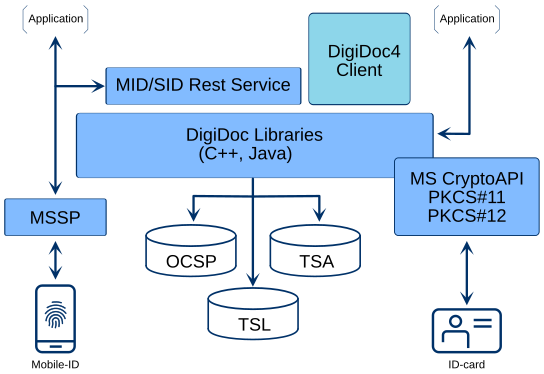
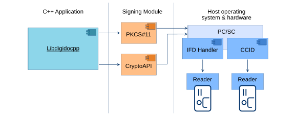

# Libdigidocpp

Libdigidocpp is a C++ library for creating, signing, and verifying digitally
signed documents. Digitally signed files are created as Associated Signature
Containers ([ASiC](#ASiC)), using the .asice file extension, with XML
Advanced Electronic Signatures ([XAdES](#XAdES)), both standardized by the
European Telecommunications Standards Institute (ETSI).

Additionally, the libdigidocpp library can create, save, read, validate, and
extend digitally timestamped containers (using the .asics file extension) with
a single data file and [RFC 3161](#RFC3161) time-stamp tokens. ASiC
containers with [CAdES](#CAdES) signatures, [PDF](#PDF), and
[DDOC](#DDOC) files can be validated with the [SiVa](#SiVa) service.

Libdigidocpp is part of the DigiDoc framework, together with the Java
libraries, the SiVa validation service and end-user applications such as
DigiDoc4. All components use the same signed file formats.

The library is developed on GitHub:
- Source code, issues and releases: https://github.com/open-eid/libdigidocpp
- Additional documentation in the wiki: https://github.com/open-eid/libdigidocpp/wiki

The library is documented on the following separate pages:
- [Libdigidocpp Programmer's Guide](programmer-guide.md) – using the API
- [Supported container formats](formats.md)
- [Configuration guide](configuration.md)
- [digidoc-tool](digidoc-tool.md) – command-line utility
- [Implementation notes](implementation.md)
- [Standards and references](references.md)
- [Terms and acronyms](terms.md)
- [Release Notes](../RELEASE-NOTES.md) – changes by version

## Overview {#overview}

### Supported functional properties {#Supported}

Libdigidocpp is a library of C++ classes offering the functionality of handling
digitally signed files in supported DigiDoc formats. The following functions
are implemented:
- creating containers in supported DigiDoc formats and adding data files;
- creating digital signatures using smart cards or other supported
  cryptographic tokens;
- adding time marks and validity confirmations to digital signatures using
  OCSP and time-stamping protocols;
- validating the digital signatures;
- using trust service status lists (TSL) as trust anchors for certificate
  validation;
- extracting data files from a container;
- removing signatures and data files from a container.

The functional features supported with Libdigidocpp are:

- **DigiDoc document format**
  - ASiC-E – the main document format to be used.
  - ASiC-S – a single-data-file container. Opening and validating XAdES
    signatures are supported; this variant is read-only. For
    [RFC 3161](#RFC3161) TimeStampToken containers, creation, saving,
    validation, and archive-manifest time-stamp extension are supported. A
    TimeStampToken container that encloses a legacy DDoc file also exposes the
    DDoc's data files and signatures, validated by the [SiVa](#SiVa) service (see
    [ASiC-S container format](#asics)).
  - BDOC 2.1 – legacy read-only compatibility.
  - Lithuanian ADOC V1.0 – legacy read-only compatibility for opening and
    locally validating XAdES signatures. Creating, modifying, signing, and
    saving ADOC containers are not supported.

  > [!NOTE]
  > BDOC 1.0 file format is not supported (more info can be found from
  > https://www.id.ee/en/article/digidoc-container-format-life-cycle-2/).

- **Signature profile** – signature profiles are based on the profiles defined
  by XAdES ([XAdES](#XAdES)).
  - time-stamp (TS) – signature profile in case of which the certificate
    validity information is added to the signature with an
    [RFC 6960](#RFC6960) OCSP confirmation; the signing time information is
    added with an [RFC 3161](#RFC3161) time-stamp token retrieved from a
    time-stamping service. In this case, signature creation time is regarded
    as the issuance time of the time-stamp token
    ([RFC 3161 TSTInfo.genTime](#RFC3161)).
  - time-mark (TM) – certificate validity and signing time information is
    added to the signature with a time-mark - a special OCSP confirmation in
    case of which the hash value of the binary value of the signature (along
    with hash algorithm identifier in case of BDOC 2.1 document format) must be
    present in the "nonce" field of the OCSP confirmation. In this case,
    signature creation time is regarded as the issuance time of the OCSP
    confirmation (producedAt value in the confirmation), additional time-stamp
    token is not required.
  - archive time-stamp (TSA/LTA) – the signature and its accompanying
    validation data are time-stamped to provide long-term validity. Eligible
    ASiC-E XAdES signatures receive an ArchiveTimeStamp element. ASiC-S
    TimeStampToken signatures are extended with an ASiC archive manifest and
    another [RFC 3161](#RFC3161) time-stamp token.

- **Trust anchors** – information of trusted CA certificates (trust anchors) is
  used to validate the trustworthiness of certificates used in the signature.
  The signer certificate's CA, OCSP responder certificate and time-stamping
  service's certificate (in case of TS signature profile) must be trusted.
  Trusted certificates' information is obtained from TSL list (Trust Service
  status list), the trusted certificates' list is retrieved from a signed TSL
  list that provides information about the status and the status history of
  the trust services (including certification, OCSP confirmation and
  time-stamping services). The European Commission's TSL list is used, more
  information of which can be found from
  https://ec.europa.eu/information_society/policy/esignature/trusted-list/.
  For the TSL specification document, see also [Trusted Lists](#TSL). For
  more information about the TSL implementation and configuration
  possibilities in Libdigidocpp library, see
  [TSL list usage in Libdigidocpp](#TSL-overview) and
  [Trust anchor/TSL settings](#CA-settings).

- **Signature creation module**
  - PKCS#11 – in Linux and macOS environments, the default module for signing
    with smart card (e.g. Estonian ID card or any other smartcard provided that
    you have the external native PKCS#11 driver for it).
  - Windows CryptoAPI – the default module for signing with smart card in
    Windows environment. By default, a dialog window is opened for the user to
    choose the signing certificate and enter PIN code.

- **Cryptographic token type**
  - Smart card, e.g. Estonian ID card. Supported signature creation modules are
    PKCS#11 and Windows CryptoAPI.

  > [!NOTE]
  > Usage of SafeNet USB tokens with a Digital Stamp certificate
  > (https://www.skidsolutions.eu/en/services/Digital-stamp) has been tested
  > indirectly with Libdigidocpp through the DigiDoc desktop application, which
  > uses Libdigidocpp as a base layer.

- **Public-key algorithm**
  - RSA
  - ECDSA

### Component model {#Component}

The figure below describes the architecture of software and hardware components
that are used when creating signatures with Libdigidocpp library.

- **PKCS#11** – widely adopted platform-independent API to cryptographic tokens
  (HSMs, smart cards and USB tokens), a standard management module of the
  cryptographic token and its certificates.
- **CryptoAPI** – Microsoft Cryptography API. Programming API for implementing
  cryptographic functions in Windows environment.
- **PC/SC** – standard communication interface between the computer and the
  smart card, a cross-platform API for accessing smart card readers.
- **IFDHandler** – Interface Device Handler for CCID readers.
- **CCID** – USB driver for Chip/Smart Card Interface Devices.
- **Reader** – device used for communication with a smart card.

## Supported identity tokens {#tokens}

Libdigidocpp library supports the following identity tokens:
- Estonian national eID card and Digi-ID

The library is also tested with the following tokens (indirectly via the
DigiDoc desktop application that uses Libdigidocpp as a base component):
- Finnish national eID card
- Latvian national eID card
- Lithuanian national eID card
- SafeNet eToken 5110 with SK issued certificates for organizations
