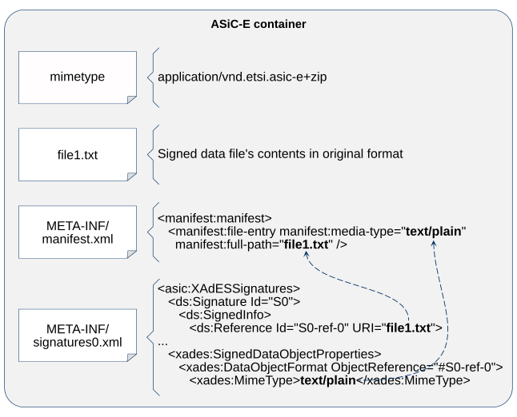
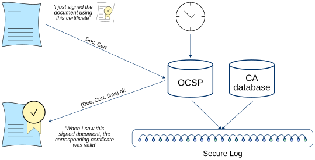

# Supported container formats {#formats}

Actively used digitally signed file formats in DigiDoc system are:
- ASiC-E - default format for files in Libdigidocpp library, described in \ref ASiC "The ETSI standard ETSI EN 319 162-1";
- BDOC 2.1 - legacy format, described in \ref BDOC "BDOC2.1:2013", The library implements only read-only support for the format;
- ASiC-S - simple signature container, described in \ref ASiC "The ETSI standard ETSI EN 319 162-1". The library supports opening and validating containers with XAdES signatures. For containers with \ref RFC3161 "RFC 3161" time-stamp tokens, creating, saving, reading, validating, and archive-manifest time-stamp extension are supported.

The following chapters provide an overview of the ASiC-E (XAdES) digitally signed file format, which is the preferred format for creating signed documents with Libdigidocpp.

## ASiC-E (XAdES) container format {#container}

The ETSI standard \ref ASiC "EN 319 162-1" defines a container format for encapsulating signed files, signatures, and supporting information. ASiC-E documents use the Extended form and contain signatures conforming to \ref XAdES "XAdES EN 319 132-1".

ASiC-E container is a ZIP file consisting of the following objects:
- a file named "mimetype", containing only the following value: `application/vnd.etsi.asic-e+zip`
- data files in original format.
- META-INF subdirectory, consisting of:
  - `manifest.xml` – a file containing list of all files in the container. The list does not contain the "mimetype" file and files in META-INF subdirectory.
  - `signatures*.xml` – one file for each signature, ‘`*`’ in the file’s name denotes the sequence number of a signature (counting starts from zero). The `signatures*.xml` file also incorporates certificates, validity confirmation and meta-data about the signer.

When ASiC-E container is signed then all files in the container are signed, except of the mimetype file and files in META-INF subdirectory.

Original files (which were signed) along with the signature(s), timestamp(s), validation confirmation(s) and certificates are encapsulated within the container. As a result, it is possible to verify signature validity without any additional external information – the verifier should trust the issuer of signer’s certificate, TS Authority and the OCSP responder’s certificate.



## Legacy BDOC signature profiles {#profiles}

The format of the BDOC 2.1 digitally signed file is based on ETSI \ref XAdES "XAdES TS 101 903" standard. The XAdES standard defines formats for advanced electronic signatures that remain valid over long periods of time. The ETSI standard \ref XAdES "TS 103 171" "XAdES Baseline Profile" further profiles the XAdES signature by putting limitations on choices.

BDOC 2.1 specification defines two profiles of qualified BDOC signatures: BDOC with time-mark and BDOC with time-stamp. Both of the profiles offer long-term validation possibility by incorporating the necessary validation data in the signature. Both of the profiles are compliant to XAdES LT-Level requirements.

### BDOC signature with time-mark {#BDOC-TM}

The BDOC signature with time-mark is based XAdES-EPES signature (Explicit Policy based Electronic Signature, see \ref XAdES "XAdES").

In order to offer long time validation, it is necessary to obtain proof of validity of the signer’s X.509 digital certificate issued by a certificate authority (CA) at the time of signature creation. In case of BDOC with time-marks (TM profile), the proof is obtained with a single OCSP response that has a specific "nonce" field’s value (i.e. the time-mark).

The hash of the created signature (the `<SignatureValue>` element’s contents) is sent within the OCSP request’s and received back within the response’s "nonce" field. The OCSP request’s and response’s "nonce" field is a DER-encoding of the following ASN.1 data structure:

```
TBSDocumentDigest ::= SEQUENCE {
    algorithm AlgorithmIdentifier,
    digest OCTET STRING
}
```

The element digest is a hash value of the binary value of the `<SignatureValue>` element’s contents, element algorithm determines the used hash algorithm as defined in \ref RFC5280 "RFC 5280" clause 4.1.1.2.

**The time-mark provides proof of the following:**
1. The signature value existed at a certain point of time (issuance time of the OCSP confirmation) – the verifier can calculate the hash of the signature and check its conformance to the OCSP response’s "nonce" field.
2. The signer’s certificate was valid (provided that the OCSP response is positive and does indeed confirm the certificate’s validity) at a certain point of time

It is important to notice that additional time-stamps are not necessary as time of signing and time of obtaining validity information is indicated in the OCSP response (i.e. the time-mark).

> [!NOTE]
> The issuance time (producedAt field’s value) of the OCSP response (the time-mark) is regarded as the time of signature creation.

To achieve long-time validity of digital signatures, a secure log system is employed within the model. All OCSP responses and changes in certificate validity are securely logged to preserve digital signature validity even after private key compromise of CA or OCSP responder.



### BDOC signature with time-stamp {#BDOC-TS}

The BDOC signature with time-stamp is based on XAdES-BES signature (Basic Electronic Signature, see \ref XAdES).

In order to offer long time validation, it is necessary to obtaining proof of validity of the signer’s X.509 digital certificate issued by a certificate authority (CA) at the time of signature creation.

In case of BDOC with time-stamp (TS profile), the proof is provided as follows:
1. A time-stamp compliant with \ref RFC3161 "RFC 3161" is obtained from a time-stamping service. The hash of the created signature (`<SignatureValue>` element block) is sent to the time-stamping server. The server’s response contains a time-stamp token with the same hash value that can later be used to validate that the time-stamp was indeed issued for the respective signature. The time-stamp token received from the server is added to the signature providing a proof from a trusted source that the signature value existed at a certain point of time.
2. An \ref RFC6960 "RFC 6960" compliant OCSP confirmation is obtained from an OCSP service. The OCSP response received from the server is used as a trusted source to confirm that the signer’s certificate was valid at a certain point of time (producedAt field’s value in the OCSP response).
3. The verifier must check the time-stamp token’s and OCSP confirmation’s time difference. If the difference is acceptable then it can stated that the signer’s certificate was valid at the time of signature creation.

> [!NOTE]
> The \ref RFC3161 "RFC 3161 TSTInfo.genTime" field records when the TSA created the time-stamp token. This issuance time is regarded as the time of signature creation.

## ASiC-S container format {#asics}

In addition to the Associated Signature Extended form (ASiC-E), the \ref ASiC "ETSI standard EN 319 162-1" defines a Simple form which is used for encapsulating a single data file and a signature or time-stamp token associated with it.

An ASiC-S container is a ZIP file consisting of the following objects:
- an optional file named "mimetype", containing only the following value: `application/vnd.etsi.asic-s+zip`
- data object (file) in original format.
- one signature form:
  - `META-INF/signatures.xml` containing XAdES signatures; or
  - `META-INF/timestamp.tst` containing the initial \ref RFC3161 "RFC 3161" time-stamp token.
- for the time-stamp-token form, optional `META-INF/ASiCArchiveManifest*.xml` and `META-INF/timestamp*.tst` files containing additional archive-manifest time-stamp layers.

Since version 3.17.0, libdigidocpp can open and locally validate ASiC-S containers containing XAdES signatures in `META-INF/signatures.xml`. This variant is read-only: creating, adding signatures to, and saving ASiC-S/XAdES containers are not supported.

The library also supports local creation and validation of ASiC-S containers with a time-stamp token (the container includes `META-INF/timestamp.tst`). The time-stamp token is a binary representation of TimeStampToken as defined in \ref RFC3161 "RFC 3161". The time-stamp is obtained from a time-stamping service and is calculated over the entire binary content of the data object.
Since both the original file and time-stamp are included in the container, it is possible to verify that the timestamped file existed at a certain point of time.

An existing time-stamp token can be extended by adding an ASiC archive manifest and a new time-stamp token. Each new layer protects the data object and the preceding time-stamp information. See \ref extend-validity for the high-level validity-extension workflow.

## Format compatibility notes {#implementation-notes}

These notes document signature-validation and container-serialization choices that supplement the referenced format specifications.

### Digital signature related notes {#signature-notes}

1. The supported BDOC 2.1 signature profiles are BDOC-TM (XAdES-EPES signature with time-mark) and BDOC-TS (XAdES-BES signature with time-stamp and OCSP confirmation).
   The basic BDOC-TM profile is XAdES-EPES as BDOC 2.1 specification requires that `<SignaturePolicyIdentifier>` element is present (\ref BDOC "BDOC2.1:2013", chap. 5.2). The basic BDOC-TS profile is XAdES-BES as the `<SignaturePolicyIdentifier>` element is not supported in case of BDOC 2.1 signatures with time-stamps.
   It is expected that either a time-mark or time-stamp and OCSP confirmation have been added to the signature as according to BDOC 2.1 specification (\ref BDOC "BDOC2.1:2013", chap. 6) a signature is not considered complete or valid without validation data from external services (i.e. a time-mark or time-stamp).
2. For better international compatibility reasons, the library also accepts BDOC-TS signatures that are based on XAdES-EPES basic profile during validation time (i.e. the signature contains `<SignaturePolicyIdentifier>` element and a time-stamp).
3. One time-mark is allowed for each signature in case of TM profile; one time-stamp and one OCSP confirmation are allowed for each signature in case of TS profile (due to security reasons and in order to maintain testing efficiency).
4. In case of BDOC signature with time-mark, the OCSP confirmation's (i.e. time-mark's) nonce field’s value is calculated as follows:
   - the contents of `<SignatureValue>` element (i.e. the value without XML tags) is taken and decoded from base64 encoding;
   - digest of the value found in the previous step is calculated by using SHA-256 algorithm.;
   - the digest value found in the previous step and the digest algorithm that was used are transformed as defined by the following ASN.1 structure:
     ```
     TBSDocumentDigest ::= SEQUENCE {
         algorithm AlgorithmIdentifier,
         digest OCTET STRING
     }
     ```
   - the ASN.1 block value produced in the previous step is included in the OCSP request’s "nonce" field and must be present in the respective field of the OCSP response.
5. In case of signing with ECC keys (by using ECDSA algorithm), concatenation method is used for creating signature value.
6. By default, data file digests use `signer.digestUri` and RSA signatures use `signer.signatureDigestUri`, both configured as SHA-256 by default. Unless a signature method is set explicitly, ECDSA uses SHA-224 for 224-bit keys, SHA-256 for 256-bit keys, SHA-384 for 384-bit keys, and SHA-512 for other key sizes (including 521-bit keys).
7. When SHA-1, SHA-224 or SHA3-224 has been used then a warning message about weak digest method is produced to the user. SHA-224 is discontinued by \ref CryptoSuites "ETSI TS 119 312 V2.1.1" Annex D and SHA3-224 is not listed there at all, so ECDSA with SHA3-224 is not supported. It is recommended to regard the error as a validation warning (identically to DigiDoc desktop application and digidoc-tool.cpp utility program).
8. During signature creation, it is checked that there is only one `<ClaimedRole>` element in the signature, which contains the signer’s role and optionally the signer’s resolution. If the `<ClaimedRole>` element contains both role and resolution then they must be separated with a slash mark, e.g. "role / resolution". Note that when setting the resolution value then role must also be specified.
9. XML namespace prefixes are used in case of all XML elements (e.g. "asic:", "ds:", "xades:").
10. The data file’s MIME type that is used in case of Libdigidocpp’s utility program is always "application/octet-stream" for testing purposes.
11. The `<ds:Signature>` element’s Id attribute value is set to `"S<seq_no>"` during signature creation where sequence numbers are counted from zero. Other Id values that are used in the sub-elements of the `<ds:Signature>` element contain the signature’s Id value as a prefix. During verification, different Id attribute values are also supported but are not tested periodically.
12. `signatures*.xml` file's XML structure validation is done on the basis of XAdES XML Schema (\ref XAdES), however, there are additional checks to determine any unsupported elements that are allowed by the XAdES specification. The unsupported elements are CounterSignature, AttributeCertificateRefs, AttributeRevocationRefs, RefsOnlyTimeStamp, AttrAuthoritiesCertValues, AttributeRevocationValues, CommitmentTypeIndicationType, AllDataObjectsTimeStamp, IndividualDataObjectsTimeStampType.
13. Special characters in URI attribute values are handled according to \ref RFC3986 "RFC 3986" (since v3.9 of the library): the characters are percent-encoded, except of unreserved characters and delimiters. Both percent-encoded and non-percent-encoded characters are supported during signature's validation.
14. When validating a BDOC-TS document then the difference between the OCSP validity confirmation's production time (producedAt field) and the time-stamp token's creation time (\ref RFC3161 "RFC 3161 TSTInfo.genTime") is checked. An exception is thrown if the OCSP confirmation's time is earlier than the time-stamp's time. If the OCSP confirmation's time is later than the time-stamp's time by more than 15 minutes then a warning is returned. If the difference is more than 24 hours then an exception is thrown.
15. During signature creation, it is checked that the difference between the signer's computer time and the OCSP response's production time (producedAt value) would not exceed 15 minutes. If the difference exceeds 15 minutes then an exception is returned and signing is cancelled.

### Container related notes {#container-notes}

1. ASiC-E files are created with .asice or .sce file extension.
2. Signatures are stored in `META-INF/signatures*.xml` files where ‘`*`’ is a sequence number, counting is started from zero.
3. It is not allowed to add two data files with the same name to the container as the signed data file must be uniquely identifiable in the container.
4. All data files in the container must be signed. All signatures in the container must sign all of the data files.
5. Relative file paths are used, for example `META-INF/signatures*.xml` and `document.txt` instead of `/META-INF/signatures*.xml` and `/document.txt` to ensure better interoperability with third party applications when validating signatures.
6. The ZIP container’s comment field contains application name of the library that was used for creating the file. The value can be useful, for example, when trying to determine the origin of an erroneous file.
7. "mimetype" file is not compressed in the ASiC-E file’s ZIP container as the results of ASiC plug-tests event shows that this solution is most widely used.
8. When a data file is added to the container then the modification time of the file (as it is registered in the file system) is preserved also in the ZIP container file. There is an exception if the file is added by reading it from an input stream - in that case, the current timestamp value is registered as "last modified" time in the ZIP file.
