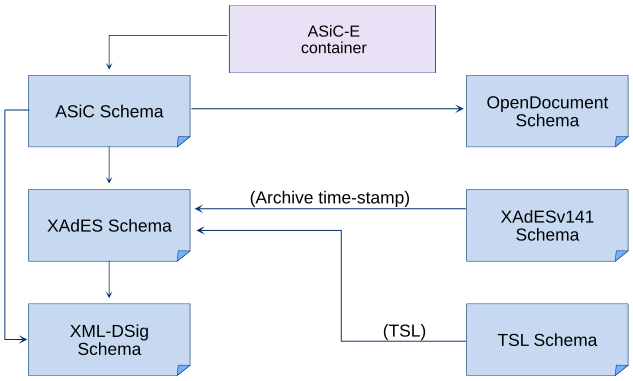

# Implementation notes {#implementation}

This page documents build dependencies, bundled schema adaptations,
interoperability testing, and certificate-validation behavior relevant to
maintainers and advanced integrators.

## Dependencies {#Dependencies}

### Software libraries {#libraries}

Libdigidocpp library depends on the software libraries listed below.
- OpenSSL (required) – Used for validating certificates and digest values.
- libxml2 (required) – Used for validating the documents according to XML
  Schema, reading and writing XML.
- xmlsec (required) – Used for handling signature related components.
- ZLIB (required) – Used when compressing and extracting ASiC files in ZIP
  format.
- Minizip (required) – Used when creating and opening ZIP container for ASiC
  file. If the component is not found from system then bundled version with
  source code is used. Forms a part of ZLIB component.
- PKCS11 (optional) – Used for searching for default PKCS#11 driver in the
  system so that its path could be registered in configuration entries.
- Doxygen (optional) – Used for generating API documentation from source code.
- SWIG (optional) – Used for creating C#, Java, and Python bindings.

### XML Schemas {#Schemas}

Several XML schemas are used when creating digitally signed documents in ASiC
file format and validating their structure. The schemas are included in
etc/schema/ subdirectory of the Libdigidocpp distribution package, their
description is given in the list below.

> [!NOTE]
> Some modifications have been made to some of the schemas. Differences in
> comparison with the original schemas are listed in section
> \ref schema-modification of the current document.

- `OpenDocument_manifest_v1_2.xsd` – OASIS OpenDocument v1.2
  (\ref OpenDocument "OpenDocument"). Defines the structure of
  META-INF/manifest.xml file in ASiC container.
  https://docs.oasis-open.org/office/v1.2/os/OpenDocument-v1.2-os-manifest-schema.rng
- `OpenDocument_dsig.xsd` – OASIS OpenDocument v1.2
  (\ref OpenDocument "OpenDocument"). Defines the structure of
  META-INF/signature.xml file in ADOC container.
  https://docs.oasis-open.org/office/v1.2/os/OpenDocument-v1.2-os-dsig-schema.rng
- `en_31916201v010101.xsd` – Associated Signature Containers
  (\ref ASiC "ASiC"). Defines the format of container for encapsulating the
  signed documents, signatures and additional information.
  http://www.etsi.org/deliver/etsi_ts/102900_102999/102918/01.02.01_60/
- `xmldsig-core-schema.xsd` – XML Signature Core Schema Instance
  (\ref XML-DSIG "XML-DSIG"). Defines XML syntax for digital signatures.
  http://www.w3.org/TR/2008/REC-xmldsig-core-20080610/xmldsig-core-schema.xsd
- `XAdES01903v132-201601.xsd` – XML Advanced Electronic Signatures
  (\ref XAdES "XAdES EN"). Defines a set of extensions to XML-DSIG making it
  suitable for advanced electronic signature.
  http://uri.etsi.org/01903/v1.3.2/XAdES01903v132-201601.xsd
- `XAdES01903v141-201601.xsd` – Defines XML syntax for additional elements of
  XAdES signatures that were added with version 1.4.1 of the
  (\ref XAdES "XAdES EN") standard. Used for XAdES archive time-stamps,
  including the ArchiveTimeStamp element.
  http://uri.etsi.org/01903/v1.4.1/XAdES01903v141-201601.xsd
- `ts_119612v020201_201601xsd.xsd`, `ts_119612v020101_additionaltypes_xsd.xsd`,
  `ts_119612v020101_sie_xsd.xsd` – Defines the format of Trust Service status
  Lists (\ref TSL) that contain information about trusted CA, OCSP and TSA
  certificates.
- `conf.xsd` – Configuration properties’ schema. Defines the Libdigidocpp
  configuration file’s digidocpp.conf structure (see also
  \ref configuration).

The following figure describes dependencies between the abovementioned schemas
(direction of the arrow indicates the direction of dependency).



### XML schema modifications {#schema-modification}

The following section describes modifications that have been made to XML
schemas used in Libdigidocpp. The library uses several XML schemas when creating
digitally signed documents and validating their structure. The schemas are
included in etc/schema/ subdirectory of the Libdigidocpp distribution package,
their description has been provided in section \ref Schemas.

Modifications are marked between xml comment tags.

OASIS publishes the OpenDocument schemas in RELAX NG only, so
`OpenDocument_manifest_v1_2.xsd` and `OpenDocument_dsig.xsd` are not
distributed by OASIS but generated from the .rng files shipped alongside them
in etc/schema/, using [Trang](https://relaxng.org/jclark/trang.html):
```sh
java -jar trang.jar OpenDocument-v1.2-os-manifest-schema.rng OpenDocument_manifest_v1_2.xsd
java -jar trang.jar OpenDocument-v1.2-os-dsig-schema.rng OpenDocument_dsig.xsd
```
Trang carries the OASIS copyright notice across into its output. The
modifications listed below are applied to the generated files afterwards, so
regenerating a schema means re-applying them.

**Schema en_31916201v010101.xsd**

1. The schema’s location has been altered so that the imported schema file is
   looked up from the local file system.
   ```xml
   <xsd:import namespace="http://www.w3.org/2000/09/xmldsig#" schemaLocation="xmldsig-core-schema.xsd"/>
   <!-- originally "http://www.w3.org/TR/2002/REC-xmldsig-core-20020212/xmldsig-core-schema.xsd" -->
   ```
2. Additional schema’s location imports has been added so that the imported
   schema file is looked up from the local file system.
   ```xml
   <xsd:import namespace="http://uri.etsi.org/01903/v1.3.2#" schemaLocation="XAdES01903v132-201601.xsd"/>
   <xsd:import namespace="http://uri.etsi.org/01903/v1.4.1#" schemaLocation="XAdES01903v141-201601.xsd"/>
   ```

**Schema xmldsig-core-schema.xsd**

1. The XMLSchema.dtd reference has been commented out due to implementation
   issues (otherwise a warning message would be produced).
   ```xml
   <!--
   <!DOCTYPE schema
     PUBLIC "-//W3C//DTD XMLSchema 200102//EN" "http://www.w3.org/2001/XMLSchema.dtd"
    [
      <!ATTLIST schema
        xmlns:ds CDATA #FIXED "http://www.w3.org/2000/09/xmldsig#">
      <!ENTITY dsig 'http://www.w3.org/2000/09/xmldsig#'>
      <!ENTITY % p ''>
      <!ENTITY % s ''>
     ]>
   -->
   ```
2. The initial integer data type used in the original schema is converted into
   long data type when generating C++ source code from the current schema.
   However, as the SK issued certificates’ serial numbers are too long to fit
   into long type variable then the data type has been changed to string.
   ```xml
   <complexType name="X509IssuerSerialType">
     <sequence>
       <element name="X509IssuerName" type="string"/>
       <element name="X509SerialNumber" type="string"/> <!-- originally type="integer" -->
     </sequence>
   </complexType>
   ```

**Schema XAdES01903v132-201601.xsd**

1. The schema’s location has been modified so that the file is looked up from
   the local file system.
   ```xml
   <xsd:import namespace="http://www.w3.org/2000/09/xmldsig#" schemaLocation="xmldsig-core-schema.xsd"/>
   <!-- originally "http://www.w3.org/TR/2002/REC-xmldsig-core-20020212/xmldsig-core-schema.xsd" -->
   ```
2. The "type" attribute has been added, otherwise a warning message would be
   produced.
   ```xml
     <xsd:complexType name="SignaturePolicyIdentifierType">
       <xsd:choice>
         <xsd:element name="SignaturePolicyId" type="SignaturePolicyIdType"/>
         <xsd:element name="SignaturePolicyImplied" type="AnyType"/> <!-- added type="AnyType" -->
       </xsd:choice>
     </xsd:complexType>
   ```
3. The "type" attribute has been added, otherwise a warning message would be
   produced.
   ```xml
     <xsd:complexType name="CommitmentTypeIndicationType">
       <xsd:sequence>
         <xsd:element name="CommitmentTypeId" type="ObjectIdentifierType"/>
         <xsd:choice>
           <xsd:element name="ObjectReference" type="xsd:anyURI"
             maxOccurs="unbounded"/>
           <xsd:element name="AllSignedDataObjects" type="AnyType"/> <!-- added type="AnyType" -->
         </xsd:choice>
         <xsd:element name="CommitmentTypeQualifiers"
           type="CommitmentTypeQualifiersListType" minOccurs="0"/>
       </xsd:sequence>
     </xsd:complexType>
   ```
4. Change child elements of type SignedSignaturePropertiesType from
   "xsd:sequence" to "xsd:all" in order to allow the child elements to be
   listed in any order.
   ```xml
   <xsd:complexType name="SignedSignaturePropertiesType">
     <xsd:all>
       <xsd:element ref="SigningTime" minOccurs="0"/>
       <xsd:element ref="SigningCertificate" minOccurs="0"/>
       <xsd:element ref="SigningCertificateV2" minOccurs="0"/>
       <xsd:element ref="SignaturePolicyIdentifier" minOccurs="0"/>
       <xsd:element ref="SignatureProductionPlace" minOccurs="0"/>
       <xsd:element ref="SignatureProductionPlaceV2" minOccurs="0"/>
       <xsd:element ref="SignerRole" minOccurs="0"/>
       <xsd:element ref="SignerRoleV2" minOccurs="0"/>
       <xsd:any namespace="##other" minOccurs="0" maxOccurs="unbounded"/>
     </xsd:all>
     <xsd:attribute name="Id" type="xsd:ID" use="optional"/>
   </xsd:complexType>
   ```
5. Change child elements of type SignatureProductionPlaceType from
   "xsd:sequence" to "xsd:all" in order to allow the child elements to be
   listed in any order.
   ```xml
   <xsd:complexType name="SignatureProductionPlaceType">
     <xsd:all>
       <xsd:element name="City" type="xsd:string" minOccurs="0"/>
       <xsd:element name="StateOrProvince" type="xsd:string" minOccurs="0"/>
       <xsd:element name="PostalCode" type="xsd:string" minOccurs="0"/>
       <xsd:element name="CountryName" type="xsd:string" minOccurs="0"/>
     </xsd:all>
   </xsd:complexType>
   ```

**Schema XAdES01903v141-201601.xsd**

1. The schema's location has been modified so that the file is looked up from
   the local file system.
   ```xml
   <xsd:import namespace="http://uri.etsi.org/01903/v1.3.2#" schemaLocation="XAdES01903v132-201601.xsd"/>
   <!-- originally "http://uri.etsi.org/01903/v1.3.2/XAdES01903v132-201601.xsd" -->
   ```

**Schema ts_119612v020201_201601xsd.xsd**

1. The schemas' locations have been modified so that the file is looked up
   from the local file system.
   ```xml
   <xsd:import namespace="http://www.w3.org/XML/1998/namespace" schemaLocation="xml.xsd"/>
   <!-- originally "http://www.w3.org/2001/xml.xsd" -->
   <xsd:import namespace="http://www.w3.org/2000/09/xmldsig#" schemaLocation="xmldsig-core-schema.xsd"/>
   <!-- originally "http://www.w3.org/TR/2002/REC-xmldsig-core-20020212/xmldsig-core-schema.xsd" -->
   ```
2. The schemas' locations have been added so that TSL extension content can be
   validated through lax processing.
   ```xml
   <xsd:import namespace="http://uri.etsi.org/TrstSvc/SvcInfoExt/eSigDir-1999-93-EC-TrustedList/#" schemaLocation="ts_119612v020101_sie_xsd.xsd"/>
   <xsd:import namespace="http://uri.etsi.org/02231/v2/additionaltypes#" schemaLocation="ts_119612v020101_additionaltypes_xsd.xsd"/>
   ```

**Schema ts_119612v020101_sie_xsd.xsd**

1. The schemas' locations have been modified so that the file is looked up
   from the local file system.
   ```xml
   <xsd:import namespace="http://uri.etsi.org/01903/v1.3.2#" schemaLocation="XAdES01903v132-201601.xsd"/>
   <!-- originally "http://uri.etsi.org/01903/v1.3.2/XAdES.xsd" -->
   ```

**Schema ts_119612v020101_additionaltypes_xsd.xsd**

1. The schemas' locations have been modified so that the file is looked up
   from the local file system.
   ```xml
   <xsd:import namespace="http://uri.etsi.org/02231/v2#" schemaLocation="ts_119612v020201_201601xsd.xsd"/>
   <!-- originally "http://uri.etsi.org/19612/v1.2.1/tsl.xsd" -->
   <xsd:import namespace="http://uri.etsi.org/01903/v1.3.2#" schemaLocation="XAdES01903v132-201601.xsd"/>
   <!-- originally "http://uri.etsi.org/01903/v1.3.2/XAdES.xsd" -->
   ```

## Online validation through SiVa {#siva-requests}

PDF files, legacy DDoc files and ASiC containers with CAdES signatures are not
validated locally; the library sends them to the \ref SiVa service. The
document is base64-encoded into a JSON request together with its file name and
the `POLv4` signature policy, and posted to the URL configured with
`verify.serivceUri` (see \ref VerifyService-settings). When
digidoc::ConfV4::verifyServiceCerts returns a non-empty list, those certificates
are used as trust anchors for the TLS connection. The default list is empty.
The whole request is built in memory, so its size grows with the document.

What is sent depends on the format:
- PDF files and ASiC containers with CAdES signatures are sent in full,
  including the signed data files.
- DDoc files are first sent in hashcode form: the content of each
  `EMBEDDED_BASE64` `<DataFile>` element is replaced with a SHA-1 digest of
  the canonicalized element, so the data file content is not sent. If SiVa
  answers with `Bad digest for DataFile`, the library repeats the request with
  the original DDoc, including the data file content. DDoc files whose data
  files are already in `HASHCODE` form are rejected.

Applications control online access with the digidoc::ContainerOpenCB passed to
digidoc::Container::openPtr. If digidoc::ContainerOpenCB::validateOnline
returns `false`, the library does not contact SiVa and opening these formats
fails. Without a callback, SiVa is always contacted.

An ASiC-S container whose only data file is a `.ddoc` file and whose only
signature is an \ref RFC3161 "RFC 3161" time-stamp token can enclose a DDoc.
When a callback is passed and allows online validation, the enclosed DDoc is
sent to SiVa as described above. digidoc::Container::dataFiles then returns
the DDoc's data files, and digidoc::Container::signatures returns the
time-stamp token followed by the DDoc's signatures. Signatures cannot be
removed while the enclosed DDoc is exposed. Without a callback, when online
validation is not allowed, or when DDoc parsing or the SiVa request fails, the
container is opened as a plain time-stamped ASiC-S container and the `.ddoc`
file is its only data file. A SiVa report that marks a DDoc signature invalid
still exposes that signature and its validation errors.

## Interoperability testing {#testing}

### DigiDoc framework cross-usability tests {#cross-usability}

Automated cross-usability tests of digitally signed and encrypted files are
periodically carried out between different
\ref DD-libs "DigiDoc software libraries":
- Cross-usability of ASiC-E file format with TS (time-stamp) profile is tested
  between DigiDoc4j and Libdigidocpp libraries.

The interoperability tests are executed through the command line utility tools
of the software libraries (for example, in case of Libdigidocpp library, the
utility program described on the \ref digidoc-tool page).

## Certificate validation behavior {#cert-notes}

1. For certificates used to validate commitment to signed content,
   \ref nat-cert "ETSI EN 319 412-2 V2.4.1", clause 4.3.2, permits key-usage
   types A, B, and F and recommends type A. All three types include the
   "Non-repudiation" bit, also called "Content Commitment". Libdigidocpp
   normally uses this bit when selecting certificates for qualified electronic
   signature creation.
2. Signature can be created with a certificate that doesn’t have
   "Non-repudiation" value in its "Key-Usage" field when specific parameters
   have been set but validation of such signature will produce a respective
   error message and the signature is not considered as a qualified electronic
   signature.
3. During signature validation, it is checked that the validity periods of the
   signer’s certificate and all the certificates in its CA chain include the
   signature creation time (value of the time in TSA response or case time-mark
   profile producedAt field in OCSP response).
